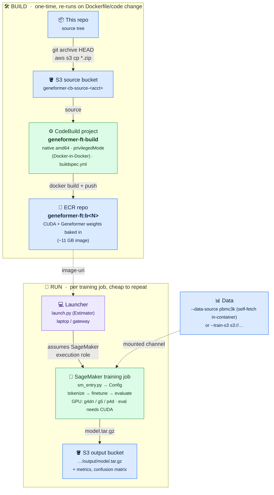

# Fine-tuning Geneformer and scGPT on readily-available GPUs

Fine-tuning single-cell foundation models is usually performed on top-of-the-line GPUs
such as the NVIDIA A100. Those are not just expensive: they are also hard to get. A100
instances are often capacity-constrained, so a job can wait for one, or fail to get one
at all. This repo shows how to fine-tune these models on the **NVIDIA A10G and T4**
instead: GPUs that cost far less and that you can usually get straight away
(`ml.g5.xlarge` and `ml.g4dn.xlarge` on SageMaker). Every result below was trained on
one of those two: Geneformer V1-10M and scGPT on a T4, Geneformer V2-104M on an A10G.
Only the largest preset, Geneformer V2-316M, needs an A100 at full precision, and with
4-bit QLoRA it fits on an A10G too (see
[QLoRA batch-size sweep](#qlora-batch-size-sweep-a10g-24-gb); that path is experimental).

This project is a standalone system for fine-tuning on your own labeled scRNA-seq data, with **two
backends**, selected by one config field:

- **[Geneformer](https://huggingface.co/ctheodoris/Geneformer)**: a transformer
  pretrained on single-cell transcriptomes, using rank-value encoding.
- **[scGPT](https://github.com/bowang-lab/scGPT)**: a generative pretrained transformer
  for single-cell data, using gene-vocab value binning.

Both are used for **cell state classification** (e.g. cell-type annotation, disease
classification). Geneformer also supports **gene classification**.

The repo wraps each model's maintained training code behind one small, config-driven CLI,
`scfm-ft` (**s**ingle-**c**ell **f**oundation **m**odel **f**ine-**t**uning; the Python
package is `scfm_ft`), so you can go from an AnnData `.h5ad` (or `.loom`) file to a
fine-tuned model + evaluation plots with one command per stage. The same `training` block
and the same held-out metrics (`accuracy`, `macro_f1`) apply to both backends, so
Geneformer and scGPT results on the same dataset are directly comparable. It also ships a
ready-to-run **AWS pipeline** (CodeBuild → ECR → SageMaker) for training on a real GPU
without a local GPU. See [Backends (Geneformer + scGPT)](#backends-geneformer--scgpt).

**Results on the PBMC3k example** (cell-type classification, held-out cells):

| Backend | Model | GPU | Accuracy | Macro-F1 | Evaluation |
|---|---|---|---|---|---|
| Geneformer | V1-10M | T4 | 0.955 | 0.87 | single 80/10/10 split |
| Geneformer | V2-104M | A10G | 0.96–0.97 | 0.94–0.95 | single 80/10/10 split |
| scGPT | `scgpt-human` | T4 | 0.933 ± 0.012 | 0.889 ± 0.033 | 5-fold cross-validation, 4 seeds |

Details: [Remote training on AWS](#remote-training-on-aws) and
[scGPT backend](#scgpt-backend--remote-training).

## What it does

```
.h5ad / .loom  ──tokenize──▶  tokenized dataset  ──finetune──▶  fine-tuned model
               (Geneformer or scGPT, per model.backend)
                                                        │
                                                        └──evaluate──▶ metrics + confusion matrix + UMAP
```

Three stages, each a CLI subcommand driven by one YAML config:

| Stage       | Command                        | Output                                      |
|-------------|--------------------------------|---------------------------------------------|
| Tokenize    | `scfm-ft tokenize`       | tokenized dataset (Geneformer rank-value / scGPT value-binned) |
| Fine-tune   | `scfm-ft finetune`       | fine-tuned model + class-label map          |
| Evaluate    | `scfm-ft evaluate`       | metrics JSON, confusion matrix, predictions |

Or run the whole thing: `scfm-ft run --config configs/example_cell.yaml`.

### All CLI subcommands

| Command            | What it does                                                        |
|--------------------|---------------------------------------------------------------------|
| `tokenize`         | `.h5ad`/`.loom` → tokenized dataset for the configured backend      |
| `finetune`         | Fine-tune the configured model (runs `tokenize` first if needed)   |
| `evaluate`         | Evaluate a fine-tuned model, write metrics + plots                 |
| `run`              | `tokenize` → `finetune` → `evaluate` end to end                    |
| `make-sample-data` | Write a tiny synthetic dataset for CPU smoke tests                 |
| `load-pbmc3k`      | Download the real 10x PBMC3k dataset and format it as a loom       |
| `validate-config`  | Parse a config and print the resolved settings                     |

## How it works

- **Config-driven.** Every run is described by one YAML file validated into a typed
  `Config` (`src/scfm_ft/config.py`). This is the single source of truth for the
  model preset, input path, label column, and training hyperparameters.
- **Tokenize** turns an AnnData/loom matrix into the input the chosen model expects.
  Geneformer ranks each gene's expression within the cell (rank-value encoding), so the
  model sees "which genes are most active in this cell" rather than raw counts. scGPT
  maps genes to its vocabulary and bins their expression values.
- **Fine-tune** attaches a classification head and trains it on your labels. Geneformer
  runs through its maintained `Classifier` API; scGPT runs through its own
  `TransformerModel`. `training.num_crossval_splits` chooses train-only (`0`), a single
  held-out split (`1`), or 5-fold cross-validation (`5`).
- **Evaluate** renders the held-out metrics, confusion matrix and prediction dump.
  When `num_crossval_splits >= 1`, finetune has already evaluated on held-out cells and
  evaluate just renders those results.
- **Model selection by preset.** `model.backend` picks Geneformer or scGPT, and
  `model.preset` picks the pretrained checkpoint. Geneformer weights live under
  `vendor/Geneformer/` locally or are baked into the training image; scGPT weights are
  staged in S3 and mounted into the job.

## Models

### Geneformer presets

| Preset    | Model              | Params | Input size | Corpus                 |
|-----------|--------------------|--------|------------|------------------------|
| `V1-10M`  | Geneformer-V1-10M  | 10M    | 2048       | ~30M cells             |
| `V2-104M` | Geneformer-V2-104M | 104M   | 4096       | ~104M cells            |
| `V2-316M` | Geneformer-V2-316M | 316M   | 4096       | ~104M cells (default)  |

### scGPT presets

| Preset        | Checkpoint directory | `d_model` |
|---------------|----------------------|-----------|
| `scgpt-human` | `scGPT_human/`       | 512       |
| `scgpt-blood` | `scGPT_bc/`          | 512       |
| `scgpt-cp`    | `scGPT_CP/`          | 512       |

`scgpt-human` is about 51M parameters (12 layers). Unlike Geneformer's public Hugging
Face repo, the scGPT weights are not downloaded for you: stage them yourself, one
directory per preset (see [scGPT backend](#scgpt-backend--remote-training)).

### Backends (Geneformer + scGPT)

The pipeline is **model-agnostic behind a `ModelBackend` interface**. `model.backend`
in the config selects which foundation model is fine-tuned; the CLI and the SageMaker
entry point dispatch through a registry and never import a model library directly.
Two backends ship today:

| Backend      | `model.backend` | Presets                                  | Tokenization            | Image                     |
|--------------|-----------------|------------------------------------------|-------------------------|---------------------------|
| Geneformer   | `geneformer`    | `V1-10M` / `V2-104M` / `V2-316M`         | rank-value encoding     | `sagemaker/Dockerfile`    |
| scGPT        | `scgpt`         | `scgpt-human` / `scgpt-blood` / `scgpt-cp` | gene-vocab value binning | `sagemaker/Dockerfile.scgpt` |

The shared `training` block (epochs, learning rate, batch size, `split_sizes`, seed,
label column) is honored identically by both backends, so Geneformer-vs-scGPT numbers
on the same dataset are directly comparable. Both emit the same held-out metric keys
(`accuracy`, `macro_f1`) and a confusion matrix.

Both backends run end to end on SageMaker. scGPT fine-tunes PBMC3k on a single T4
(`ml.g4dn.xlarge`); see [scGPT results](#scgpt-results) for numbers and known gaps.

scGPT runs from `configs/pbmc3k_scgpt.yaml` (sibling of `configs/pbmc3k.yaml` — only
`model.backend`, the preset, and the `scgpt:` block differ). Because scGPT's
`flash-attn`/`torch` stack conflicts with Geneformer's (scGPT pins torch 2.0.1), the
two backends ship as **separate images** (`Dockerfile.scgpt`), selected by
`launch.py --backend` / the buildspec `BACKEND` env var. **Adding a third model**
(scBERT, UCE, …) is one new backend module + one registry line — no shared-layer edits.

```bash
# scGPT fine-tune on PBMC3k (GPU + the scgpt-ft image):
uv run scfm-ft run --config configs/pbmc3k_scgpt.yaml
```

---

## 4-bit quantization (QLoRA) and where the memory actually goes

The Geneformer backend can fine-tune in **QLoRA** mode (`training.quantize: true`): the
base model is loaded in 4-bit and only small **LoRA adapter** matrices are trained. This
is what lets a 104M/316M model fit on a 24 GB GPU. But the thing people expect — "4-bit
makes everything ~8× smaller" — is **only true of the weights**, not of the memory that
actually dominates a training step. This section explains where the memory goes, so
you can pick a batch size that fits.

### What QLoRA does, concretely

In `src/scfm_ft/finetune.py`, `_build_quantize_config` builds the two pieces
Geneformer's `load_model` consumes:

- **4-bit base** via `BitsAndBytesConfig(load_in_4bit=True, bnb_4bit_quant_type="nf4",
  bnb_4bit_use_double_quant=True, bnb_4bit_compute_dtype=torch.bfloat16)` — the frozen
  pretrained weights are stored packed in the **nf4** (4-bit NormalFloat) format, with a
  second quantization of the per-block scales ("double quant") shaving a little more.
- **LoRA adapter** via `LoraConfig(r=64, lora_alpha=128, lora_dropout=0.1)` — a tiny pair
  of low-rank matrices added beside each quantized linear. These, plus the classification
  head, are the **only trainable parameters**.

### Which weights are 4-bit, and which are *not*

Quantization replaces each `nn.Linear` with a bitsandbytes `Linear4bit`. That covers
essentially the whole transformer mass — but several things stay full precision on
purpose, and `_kbit_prep_get_peft_model` (which runs `prepare_model_for_kbit_training`)
deliberately upcasts some of them to fp32 for numerical stability:

| Component | Quantized? | Stored dtype | Why |
|---|---|---|---|
| Encoder `nn.Linear` — Q/K/V, attention output, FFN intermediate + output | **Yes, 4-bit** | nf4 (frozen) | The bulk of the parameters; frozen, so 4-bit storage is free accuracy-wise |
| **LayerNorm** weights/biases | No | **fp32** (upcast) | Norm stats overflow under low precision (shows up as `loss 0.0, grad_norm nan`); `prepare_model_for_kbit_training` upcasts them |
| **Embeddings** (token / position) | No | bf16/fp32 | Not an `nn.Linear`, so never swapped for `Linear4bit` |
| **Classification head** (`classifier`, pooler) | No | fp32, **trainable** | Freshly added for the task; pinned via `modules_to_save=["classifier"]` so it trains in full precision |
| **LoRA adapters** (r=64, α=128) | No | bf16, **trainable** | The low-rank deltas that are actually learned |

So "4-bit" = the frozen encoder linears (≈ the whole 10M/104M/316M mass). Everything that
is *trained* — LoRA deltas + head — and everything that must stay numerically well-behaved
— LayerNorm, embeddings — is **not** 4-bit.

### Why activations are **not** quantized (the key point)

`load_in_4bit=True` controls weight **storage**; `bnb_4bit_compute_dtype` controls the
**math**. On every forward pass a `Linear4bit` **dequantizes** its nf4 weights back to
`compute_dtype` (here **bf16**) and runs the matmul in that dtype. The tensors flowing
between layers — the **activations** — are therefore bf16, *not* 4-bit. Nothing ever makes
activations 4-bit.

The consequence: **4-bit weights do not reduce activation memory at all.** Activation
memory scales with `compute_dtype`, batch size and sequence length, so the lever for
fitting a bigger run is **batch size (and sequence length), not weight quantization**.
Raising `compute_dtype` to fp32 makes it worse (full-size activations OOM on the first
step at batch 32). The code keeps `compute_dtype=bf16` and uses **gradient clipping**
(`max_grad_norm=1.0`) as the stability guard, plus optional **gradient (activation)
checkpointing** to trade compute for a smaller activation footprint.

### Memory by model size × batch size

Rough per-GPU training-memory estimates for the Geneformer QLoRA path, so you can pick a
batch size that fits before paying for a GPU. These are **computed estimates, not
measured** — the one measured point is noted below the table.

**How each column is built** (order-of-magnitude, bf16 compute):

- **4-bit weights** ≈ `params × 0.5 bytes` + double-quant/scale overhead (frozen base).
- **LoRA + head + optimizer** — trainable params are tiny (LoRA r=64 + fp32 head); their
  AdamW optimizer state is the bigger share but still small and **batch-independent**.
- **Activations** ≈ `layers × batch × seq_len × hidden × bytes × k` — the only column that
  grows with batch size, and the one that decides whether a run fits. `k` folds in the
  several intermediate tensors kept per layer for the backward pass; gradient
  checkpointing cuts this roughly by the layer count at the cost of a second forward.

| Model | Seq len | 4-bit weights | LoRA+head+opt (batch-indep.) | Activations @ bs 8 | Activations @ bs 16 | Activations @ bs 32 | **Total @ bs 8 / 16 / 32** |
|---|---|---|---|---|---|---|---|
| V1-10M  | 2048 | ~0.1 GB | ~0.3 GB | ~0.9 GB | ~1.8 GB | ~3.6 GB | **~1.3 / 2.2 / 4.0 GB** |
| V2-104M | 4096 | ~0.8 GB | ~1.2 GB | ~7 GB   | ~14 GB  | ~28 GB  | **~9 / 16 / 30 GB** |
| V2-316M | 4096 | ~2.3 GB | ~2.5 GB | ~13 GB  | ~26 GB  | ~52 GB  | **~18 / 31 / 57 GB** |

Read it as the shape of the problem, not exact figures: **weights barely move with batch
size; activations dominate and scale linearly with it.** That is why the knob to fit a run
is batch size, and why 4-bit weights alone do not rescue a large batch.

> **Measured anchor:** V2-104M on `ml.g5.xlarge` (A10G **24 GB**) **OOMs at
> `--batch-size 24`** but **fits at `--batch-size 12`** — consistent with the ~16 GB @ bs 16
> / ~30 GB @ bs 32 row above crossing 24 GB between bs 12 and bs 24. The launcher defaults
> V2-104M to `--batch-size 12` for this reason. Enable `grad_checkpointing` (scGPT backend)
> or lower the batch size to go larger on the same card.

---

## Local setup

### Requirements

- Python 3.11–3.12
- [`uv`](https://docs.astral.sh/uv/) for environment management
- `git` (git-lfs optional — see below)
- A CUDA GPU is strongly recommended for fine-tuning and **required for evaluation**
  (Geneformer's eval forward pass hardcodes CUDA). CPU runs training-only smoke tests;
  Apple-silicon MPS trains but is slow and cannot evaluate (no CUDA).

### Install

Geneformer's pretrained weights are stored as git-LFS files. You can either use
git-lfs, or — if git-lfs isn't available — clone the code and fetch just the weights
you need over HTTPS via `huggingface_hub`. `scripts/setup.sh` does the latter
automatically.

```bash
bash scripts/setup.sh          # clones Geneformer (code), installs the stack,
                               # and downloads V1-10M weights + gc30M dictionaries
```

Or manually:

```bash
# 1. Clone Geneformer code (LFS files land as small pointer stubs — that's fine)
GIT_LFS_SKIP_SMUDGE=1 git clone --depth 1 \
    https://huggingface.co/ctheodoris/Geneformer vendor/Geneformer

# 2. Env + project + the Geneformer package (code)
uv venv && uv sync
uv pip install --no-deps ./vendor/Geneformer

# 3. Fetch the real weights + dictionaries over HTTPS (no git-lfs needed)
uv run python scripts/fetch_weights.py --preset V1-10M
```

Pinned versions matter. Geneformer itself pins `transformers==4.46`, but that release
carries a critical CVE and several remote-code-execution advisories, so this project
runs it on transformers 5 (with datasets 5 and fsspec 2026, locked in `uv.lock`). Two
small build-time patches in `sagemaker/patches/` make that work: the image and
`scripts/setup.sh` apply `geneformer_transformers5.py`, which swaps the four imports
transformers 5 removed for a compat module and renames one training argument. Install
Geneformer through those, not with a bare `pip install` of the clone, which won't
import. `geneformer` is installed from the cloned repo (its token dictionaries live
inside the package), so it is not a locked PyPI dependency.

### Quickstart (local)

The default config uses **Geneformer-V1-10M** — the smallest model — so you can
develop and iterate cheaply (16 GB GPU, or CPU for the smoke test). Promote to
V2-104M (A10G/L4, 24 GB) or V2-316M (A100) for real runs by changing `model.preset`.

```bash
# Full tokenize -> finetune smoke test on tiny synthetic data, CPU-only, ~1 min.
uv run scfm-ft make-sample-data --out data/smoke.loom --n-cells 150
uv run scfm-ft finetune --config configs/smoke_test.yaml
```

This produces a real fine-tuned V1-10M classifier under `outputs/smoke/model/`.

To try the real **PBMC3k** example (~2,700 PBMCs with standard cell-type labels):

```bash
uv run scfm-ft load-pbmc3k --out data/pbmc3k.loom   # fetch + format (needs network)
uv run scfm-ft finetune --config configs/pbmc3k_mps.yaml   # train-only (CPU/MPS)
```

Evaluation (held-out metrics + confusion matrix) needs a CUDA GPU — see the remote
pipeline below, or run on a CUDA machine with `configs/pbmc3k.yaml`
(`num_crossval_splits: 1`).

### CPU vs GPU vs MPS

- **Training** runs on CPU (slowly), Apple MPS (slowly, memory-hungry), or CUDA GPU.
- **Evaluation** (the `evaluate` stage, and `finetune` with `num_crossval_splits >= 1`)
  requires a **CUDA GPU**: Geneformer's evaluation forward pass hardcodes `.to("cuda")`.
  The CPU/MPS smoke configs therefore use `num_crossval_splits: 0` (train-only).

---

## Remote training on AWS

For real metrics (held-out eval needs CUDA) without a local GPU, the `sagemaker/`
directory runs the fine-tune as a managed **SageMaker training job** on a GPU
instance. The training image is built on **AWS CodeBuild** (native x86-64) and pushed
to **ECR** — this avoids cross-building a CUDA image under QEMU on an Apple-silicon
Mac, which crashes `git lfs pull` during the weight fetch.

### Architecture



The image bakes Geneformer and its weights in, so the job downloads nothing at
runtime. The **build** step reruns only when the Dockerfile or source changes; the
**run** step is cheap to repeat with different hyperparameters against the same image.

| File | Role |
|---|---|
| `sagemaker/Dockerfile`  | Training image: CUDA 12.1 runtime + Geneformer weights (baked at build time via git-lfs) + the `scfm_ft` package. |
| `sagemaker/buildspec.yml` | CodeBuild spec: ECR login, `docker build`, push to ECR (native amd64, no QEMU). |
| `sagemaker/sm_entry.py` | Training entry point — maps SageMaker's env/hyperparameters onto a `Config` and runs tokenize → finetune → evaluate. |
| `sagemaker/launch.py`   | Submits the job via a SageMaker `Estimator`. |

### One-time setup (per account)

These resources are created once and reused by every build/run. They require an IAM
admin — the automation deliberately does **not** create IAM roles.

1. **Two IAM roles:**
   - a **CodeBuild service role** — ECR auth/push + CloudWatch Logs + read the source
     bucket;
   - a **SageMaker execution role** that the launcher passes as `--role`. Give it the
     scoped policy in `docs/iam/sagemaker-execution-policy.json` rather than
     `AmazonSageMakerFullAccess`: it can read the inputs and scGPT weights, write model
     output (`scfm-ft/output/` in the SageMaker default bucket, and nothing else there),
     pull the two training images, and write logs and metrics, and nothing else. It has no
     access to a code prefix because the launcher uploads no job code. Replace `REGION`, `ACCOUNT_ID`, `DATA_BUCKET` and `DATA_PREFIX`
     (the bucket and key prefix of your `--train-s3` URI, e.g. `pbmc3k` for
     `s3://<bucket>/pbmc3k/`; drop the `DATA_BUCKET` entries if you only use
     `--data-source pbmc3k`). Every S3 grant is limited to a key prefix, and each
     `s3:ListBucket` carries an `s3:prefix` condition, so the role can't read or list
     other keys in a shared bucket. The scGPT weights are expected under `scgpt/` in
     the weights bucket, as in the staging steps below; if yours sit at the bucket
     root, move them under `scgpt/` (an S3-to-S3 copy) or change both `scgpt/`
     entries to match. Then use `docs/iam/sagemaker-trust-policy.json` as its trust policy (it limits
     the role to SageMaker training jobs in your own account via `aws:SourceAccount`
     and `aws:SourceArn`, guarding against confused-deputy use).

     **Accepted risks.** Two statements use `"Resource": "*"` because AWS offers no
     resource-level permissions for those actions:
     - `ecr:GetAuthorizationToken` returns a registry login token; it grants no image
       access on its own, and image pulls stay limited to the two repositories by
       the `PullTrainingImages` statement.
     - `cloudwatch:PutMetricData` is narrowed by a `cloudwatch:namespace` condition to
       `/aws/sagemaker/TrainingJobs`, so the role can't write metrics anywhere else.

     The identity
     that runs `launch.py` additionally needs `sagemaker:CreateTrainingJob`,
     `sagemaker:DescribeTrainingJob`, `iam:PassRole` on this role, and write access
     to look up (and, on first use, create) the SageMaker default bucket. No job code is
     uploaded.
2. **An ECR repository** for the image, e.g. `geneformer-ft`.
3. **An S3 source bucket** for the build input, e.g. `geneformer-cb-source-<acct>`.
4. **A CodeBuild project** (x86-64 Linux, `privilegedMode=true`) whose source is the S3
   zip (or a CodeConnections git source) and whose env vars set `AWS_ACCOUNT_ID`,
   `AWS_DEFAULT_REGION`, `IMAGE_REPO_NAME` (e.g. `geneformer-ft`), `IMAGE_TAG` (e.g. `latest`).

> **Names used in the examples below.** ECR repos `geneformer-ft` (Geneformer) and
> `scgpt-ft` (scGPT), CodeBuild project `geneformer-ft-build`, source bucket
> `geneformer-cb-source-<acct>`, SageMaker execution role `GeneformerSageMakerExecution`,
> and account `123456789012` in `us-east-1`. None of these are hard-coded requirements;
> substitute your own.

## Deploy — build & push the training image

Run this whenever the Dockerfile, `sm_entry.py`, or `src/scfm_ft/` changes. It
stages the current `HEAD` as the CodeBuild source and triggers a native amd64 build.

```bash
ACCT=123456789012; REGION=us-east-1
SRC_BUCKET=geneformer-cb-source-$ACCT
CB_PROJECT=geneformer-ft-build

# 1. Stage the source zip (CodeBuild reads it as input).
git archive --format=zip -o /tmp/geneformer-src.zip HEAD
aws s3 cp /tmp/geneformer-src.zip s3://$SRC_BUCKET/geneformer-src.zip --region $REGION

# 2. Trigger the build (buildspec.yml: ECR login → docker build → push a unique `b<build number>` tag, plus the moving tag while the repository
#    is still mutable; logs a BUILD_MANIFEST line and the ECR scan report).
aws codebuild start-build --project-name $CB_PROJECT --region $REGION \
  --query 'build.id' --output text

# 3. Watch it (BUILD ~5 min + push ~4 min for the ~11 GB image).
aws codebuild batch-get-builds --ids <build-id> --region $REGION \
  --query 'builds[0].{phase:currentPhase,status:buildStatus}' --output table

# 4. Confirm the image landed in ECR.
aws ecr describe-images --repository-name geneformer-ft --region $REGION \
  --query 'sort_by(imageDetails,&imagePushedAt)[-1].[imageTags[0],imagePushedAt]' --output text
```

The resulting image is ~11 GB (CUDA + baked Geneformer weights).

> If you have a native x86-64 Docker host, you can skip CodeBuild and `docker build`
> locally instead — see `docs/SAGEMAKER.md`. Do **not** cross-build the CUDA image
> under QEMU on Apple silicon: `git lfs pull` crashes the build.

## Start a remote run

With the image in ECR, submit a training job with `launch.py`. Each run is cheap to
repeat against the same image with different hyperparameters.

```bash
ACCT=123456789012; REGION=us-east-1; PROFILE=my-training-profile
# The newest b<N> tag (the build that passed the scan gate); `latest` no longer moves.
source scripts/image_tag.sh
IMAGE_URI=$ACCT.dkr.ecr.$REGION.amazonaws.com/geneformer-ft:$(newest_build_tag geneformer-ft $REGION $PROFILE)
ROLE=arn:aws:iam::$ACCT:role/GeneformerSageMakerExecution

python sagemaker/launch.py \
  --image-uri "$IMAGE_URI" \
  --role "$ROLE" \
  --instance-type ml.g4dn.xlarge \
  --preset V1-10M --epochs 10 --batch-size 12 \
  --label-column cell_type --num-crossval-splits 1 \
  --data-source pbmc3k
```

`launch.py` forwards all hyperparameters to `sm_entry.py`. The fine-tuned model is
written to `SM_MODEL_DIR` and SageMaker uploads it to S3 (printed as
`estimator.model_data`, e.g.
`s3://sagemaker-<region>-<acct>/scfm-ft/output/<job-name>/output/model.tar.gz`).
The launcher uploads no job code: `sm_entry.py` is baked into the image, and
`launch.py` passes no `entry_point` or `source_dir`, so nothing under `sagemaker/` leaves
your machine and the job cannot be made to run code from S3. The scoped execution policy
grants the role access to the output prefix, so if you pass `--s3-prefix` or an
`--output-s3` elsewhere, update the policy to match. The SageMaker
profiler and debugger hook are turned off; nothing reads their output.

### One-command launcher (recommended)

`scripts/do-fine-tuning-job.sh` wraps `launch.py` and packages everything the manual
launch needs, so a run is a single command. It:

- bootstraps an isolated launcher venv pinned to the SageMaker **v2** SDK (idempotent —
  created on first run, reused after), so it works from a fresh clone;
- takes the training account from `AWS_ACCOUNT_ID` and resolves credentials through a
  named AWS CLI profile for that account (`--profile`, or `AWS_PROFILE_NAME`; the
  built-in default is `default`);
- fills in the newest `b<N>` build tag of the `geneformer-ft` ECR repository (or `latest` if
  none is found) and the SageMaker execution role for that account; `--image-uri` overrides it;
- picks a sensible **GPU instance and batch size per preset** (V2-104M OOMs on
  `ml.g5.xlarge` at batch 24 — the per-preset default is **12**);
- generates a timestamped job name and blocks until the job completes.

Every default is overridable with a flag (`-h` for the full list):

```bash
# V2-104M on PBMC3k with held-out eval (the default):
scripts/do-fine-tuning-job.sh

# Smaller / cheaper:
scripts/do-fine-tuning-job.sh --preset V1-10M

# Your own data staged to S3 (use your own bucket name):
scripts/do-fine-tuning-job.sh --data-s3 s3://amzn-s3-demo-bucket/mydata/

# Largest model, spot pricing:
scripts/do-fine-tuning-job.sh --preset V2-316M --instance ml.p4d.24xlarge --use-spot

# Preview the exact launch command without submitting anything:
scripts/do-fine-tuning-job.sh --dry-run
```

| Flag | Default | Meaning |
|---|---|---|
| `--preset` | `V2-104M` | `V1-10M` \| `V2-104M` \| `V2-316M` |
| `--epochs` | `10` | Training epochs |
| `--batch-size` | per-preset (12) | Per-device batch size |
| `--num-crossval-splits` | `1` | `0`=train-only, `1`=single split, `5`=5-fold CV |
| `--data-source` / `--data-s3` | `pbmc3k` | Self-fetch PBMC3k, or point at your own S3 prefix |
| `--instance` | per-preset | Override the GPU instance type |
| `--profile` | `default` | AWS CLI profile for the training account |
| `--use-spot` | off | Managed spot instances |
| `--dry-run` | off | Print the launch command and exit |

The sections below document the underlying `launch.py` flags the wrapper forwards.

**Choosing the data source:**

- **`--data-source pbmc3k`** — the job **self-fetches** the public PBMC3k dataset
  in-container (scanpy downloads it). No S3 upload needed; fully self-contained.
- **`--data-source channel`** (default) — ship a raw `.loom`/`.h5ad` or a pre-tokenized
  `.dataset` directory to an S3 prefix and pass it with `--train-s3 s3://<bucket>/pbmc3k/`.
  Tokenizing once on CPU and uploading the `.dataset` keeps GPU time spent only on
  fine-tuning.

**Running from the launcher environment:**

> **SDK note:** `launch.py` targets the SageMaker **v2** Python SDK
> (`from sagemaker.estimator import Estimator`). The v3 SDK restructured these modules;
> install `sagemaker==2.219.0` (or any 2.x) in a clean environment. Run from a directory
> where the local `sagemaker/` folder does not shadow the installed SDK.
>
> **Credentials:** the SageMaker SDK's boto3 must resolve credentials directly. If a
> named-profile session set only via `AWS_PROFILE` is not picked up, vend the
> credentials to the **default** profile and run with `env -u AWS_PROFILE`.

### Security options

`launch.py` resolves a tagged `--image-uri` to its `@sha256:` digest before submitting, so
a job runs exactly the image it printed (`Image:`); `--allow-mutable-image` skips that.
Other options (all off by default; details and account setup in
[`docs/security/aws-baseline.md`](docs/security/aws-baseline.md)):

| Flag | Effect |
|---|---|
| (default) | A job that reads S3 data (`--data-source channel`) runs under network isolation: no outbound network from the container. `--network-isolation` is still accepted and does nothing extra |
| `--allow-network` | Give the container network access (only if the job must download something). `--regulated-data` refuses it. A `--data-source pbmc3k` job always has network access because it downloads its dataset |
| `--subnets`, `--security-group-ids` | Run the job in your VPC (give both) |
| `--encrypt-inter-container-traffic` | Encrypt traffic between instances of a multi-instance job |
| `--volume-kms-key`, `--output-kms-key` | Customer-managed KMS keys for the training volume and the model output. SageMaker rejects a volume key on instance types with local NVMe storage (g4dn, g5, g6, p4d and others), which it encrypts in hardware, so the launcher refuses the flag there and `--regulated-data` does not ask for it |
| (default) | Every input channel must carry a `SHA256SUMS` that matches exactly (`scfm-ft checksums <dir>` writes one), or the job stops before reading the data. `--require-input-hashes` is still accepted and does nothing extra |
| `--allow-unverified-inputs` | Turn that requirement off, only for data you wrote yourself. A `SHA256SUMS` that is present is still checked. `--regulated-data` refuses it |
| `--manifest-sha256 train=<hash>` | Pin each channel's `SHA256SUMS` to a hash you recorded outside the bucket (`scfm-ft checksums` prints it), so a file and its manifest can't be swapped together. Required for every S3 input channel (`train`, and `weights` with `--scgpt-weights-s3`); the launcher refuses to start without it |
| `--allow-unpinned-manifest` | Launch without a pin; the job then trusts the `SHA256SUMS` in the bucket and the launcher prints a warning. `--regulated-data` refuses it |
| `--group-column <obs column>` | Split train, valid and test (and CV folds) by this column, usually the donor, so no donor has cells in both training and held-out data. Without it, splits are by cell, which inflates held-out scores on multi-donor data. Each split needs at least one group (a single-donor dataset such as PBMC3k cannot be split this way), and the Geneformer backend supports it with `--num-crossval-splits` 0 or 1 only (scGPT also with 5). The job writes `<name>_group_split.json` listing the groups in each split, and its log shows `[split] by group column ...`. Images built before this option existed ignore it and split by cell, so rebuild the image before relying on it. The wrapper takes `--group-column` directly |
| `--privacy-audit` | After training, run a membership-inference audit (`scfm_ft/privacy.py`): score the training cells and the held-out cells with the trained model and test how well a loss threshold tells them apart. Writes `<name>_privacy_audit.json` and prints `[privacy-audit]` lines: ROC AUC with a 95% interval (0.5 means this attack learns nothing), the share of training cells caught at 1% and 0.1% false-positive rate, accuracy and loss on each side, and the same test per donor when `--group-column` is set. It is a lower bound: stronger attacks can do better. Needs held-out cells (`--num-crossval-splits` 1 or 5); the Geneformer backend needs 1 and `--group-column`. Up to 20,000 cells per side are scored. `--regulated-data` turns it on. `uv run scfm-ft privacy-check <name>_privacy_audit.json` applies the release rule for sharing a model trained on human donor data (donor-level AUC at most 0.60, at most 5% of training cells caught at 1% false positives; [aws-baseline.md section 7](docs/security/aws-baseline.md#7-sharing-a-model-trained-on-human-donor-data)), and the job log prints the same verdict. Needs an image built with it: `geneformer-ft` b47 or later, `scgpt-ft` b48 or later |
| `--allow-cell-level-split` | With `--regulated-data`, launch without `--group-column`, for example for single-donor data. Printed as a warning |
| `--regulated-data` | Everything above for regulated data in one flag: isolation, hash checks and encrypted traffic on (and `--allow-network` refused), and no launch without KMS keys, a VPC, manifest pins and a `--group-column` (or `--allow-cell-level-split`) |
| `--max-input-gib`, `--max-cells` | Tighten the input size and cell-count limits |

With `scripts/do-fine-tuning-job.sh`, pass these after `--`, for example
`scripts/do-fine-tuning-job.sh --data-s3 s3://<bucket>/<prefix>/ --manifest-sha256 <hash> -- --max-run 7200`
(the wrapper's `--manifest-sha256` takes the bare hash and pins the `train` channel).
Every input `.h5ad`/`.loom` is checked from its header for size (4 GiB), cells
(1,000,000) and genes (100,000) before it is loaded; set `input.max_file_gib`,
`input.max_cells` and `input.max_genes` in the config to change them. The PBMC3k download is
checked against a pinned SHA-256. Threat status: [`docs/security/threat-mitigations.md`](docs/security/threat-mitigations.md).

### Instance sizing

| Model | Params | Input size | Instance | GPU |
|---|---|---|---|---|
| V1-10M | 10M | 2048 | `ml.g4dn.xlarge` | T4 16 GB |
| V2-104M | 104M | 4096 | `ml.g5.xlarge` | A10G 24 GB |
| V2-316M | 316M | 4096 | `ml.p4d.24xlarge` | A100 80 GB |

Add `--use-spot` for managed spot instances (cheaper; the launcher sets `max_wait`).
A V1-10M PBMC3k run on `ml.g4dn.xlarge` costs roughly **$0.20** (~16 billable minutes).

> **Batch size caveat:** V2-104M on `ml.g5.xlarge` (A10G 24 GB) runs out of GPU memory
> at `--batch-size 24` (CUDA OOM within the first few steps). Use `--batch-size 12`,
> which the one-command launcher applies by default for that preset.

**Reference results** (PBMC3k, 10 epochs, single 80/10/10 held-out split; ranges are
over two runs each):

| Preset | Instance | eval_accuracy | macro_f1 | Billable |
|---|---|---|---|---|
| V1-10M | `ml.g4dn.xlarge` (T4) | 0.955 | 0.869–0.871 | ~16 min (~$0.20) |
| V2-104M | `ml.g5.xlarge` (A10G) | 0.958–0.966 | 0.939–0.948 | ~40 min (~$0.67) |

> **5-fold CV with Geneformer needs `--split-sizes 0.8,0.2,0`.** Geneformer's
> `Classifier` first sets aside the `test` fraction, which its cross-validation never
> uses, and then evaluates each fold on `valid / (train + valid)` of the rest. With the
> default `0.8,0.1,0.1`, the five folds evaluate only about half the cells. With
> `0.8,0.2,0` they hold out every cell exactly once, matching the scGPT backend's 5-fold
> CV. The job logs a warning when coverage is incomplete. Geneformer's folds come from
> its own fixed shuffle, so `--seed` changes only its training randomness.

### transformers 5 validation

The image runs the pinned Geneformer commit on **transformers 5.22.2** (datasets 5.2.0,
fsspec 2026.9.0) instead of the 4.46.3 it declares, through the build-time patch in
`sagemaker/patches/geneformer_transformers5.py`. Two checks show the patched stack
trains the same way as the original.

**CPU, against 4.46.3.** Real V1-10M weights at the pinned commit, synthetic
400-cell / 3-class data, 5-fold × 3 epochs, three runs per stack:

- Tokenizer output is byte-identical between the two stacks.
- The same pretrained encoder weights load, and the same four head parameters
  (`bert.pooler.dense`, `classifier`) are freshly initialised.
- Folds 2–5 reproduce 4.46.3's eval loss to four decimals at every epoch, in all six
  runs. Fold 1 varies from run to run by the same amount on both stacks, so that
  variation predates the upgrade.

**GPU, PBMC3k 5-fold** (10 epochs, batch 12, `--split-sizes 0.8,0.2,0`, seed 42, so
both stacks see the same folds). Each split trains on 80% of cells and is scored on
the other 20%; together the five eval folds cover every cell once. Numbers are the
final-epoch model on both stacks.

| Preset | GPU | transformers | Accuracy | Macro-F1 | Billable |
|---|---|---|---|---|---|
| V1-10M | T4 | 4.46.3 | 0.943 ± 0.008 | 0.905 ± 0.027 | 4,022 s |
| V1-10M | T4 | 5.22.2 | 0.944 ± 0.011 | 0.910 ± 0.023 | 4,062 s |
| V1-10M | T4 | 5.22.2, OS packages upgraded | 0.940 ± 0.013 | 0.897 ± 0.022 | 4,033 s |
| V2-104M | A10G | 4.46.3 | 0.950 ± 0.008 | 0.933 ± 0.012 | 11,648 s |
| V2-104M | A10G | 5.22.2 | 0.951 ± 0.010 | 0.935 ± 0.013 | 11,576 s |

Per split, V1-10M accuracy moves by at most 0.006 and macro-F1 by at most 0.022 in
either direction; V2-104M moves by at most 0.004 on both. On both presets the means
differ by far less than one SD. That's one run per stack, and the GPU's own run-to-run
spread on these folds hasn't been measured.

The third V1-10M row reruns the same folds on the image rebuilt with `apt-get upgrade` (image `b40`, ECR scan 0 critical / 6 high, down from 35 / 185). Final-epoch per-fold accuracy was 0.941, 0.960, 0.926, 0.932 and 0.943. The means differ from the previous row by less than half an SD, so the change shows no effect on accuracy. It is again one run.

### QLoRA batch-size sweep (A10G 24 GB)

4-bit **QLoRA** fine-tuning of both V2 presets across batch sizes {4, 8, 16, 32},
all on a single **`ml.g5.xlarge` (A10G 24 GB)**, 10 epochs, PBMC3k. Accuracy and
macro-F1 are on a held-out split from a disjoint **80/10/10** train/val/test split
(no train/eval overlap).

| Model | Batch | Status | eval_accuracy | macro_f1 | Train (min) | GPU mem % |
|---|---|---|---|---|---|---|
| V2-104M | 4  | ✅ Completed | 0.966 | 0.945 | 17.1 | 20.1 |
| V2-104M | 8  | ✅ Completed | 0.962 | 0.943 | 17.8 | 38.2 |
| V2-104M | 16 | ✅ Completed | 0.966 | 0.922 | 19.6 | 74.8 |
| V2-104M | 32 | ❌ CUDA OOM | — | — | — | — |
| V2-316M | 4  | ✅ Completed | 0.966 | 0.950 | 34.6 | 41.0 |
| V2-316M | 8  | ✅ Completed | 0.966 | 0.947 | 37.7 | 79.3 |
| V2-316M | 16 | ❌ CUDA OOM | — | — | — | — |
| V2-316M | 32 | ⬛ not run   | — | — | — | — |

**Notes**

- **No accuracy cost from 4-bit QLoRA.** Every cell that fit matched or beat the
  full-precision baselines above (V2-104M ≈ 0.958–0.966, V2-316M ≈ 0.966). Accuracy
  stays in the **0.962–0.966** band across all batch sizes — the spread is run-to-run
  noise for this small task, not a batch-size trend.
- **GPU memory is the ceiling, not accuracy.** V2-104M fits through batch 16 (≈75% mem)
  and OOMs at 32; V2-316M fits through batch 8 (≈79% mem) and OOMs at 16 — exactly one
  batch step lower, tracking its ~3× parameter count.
- **Failures are genuine `torch.OutOfMemoryError`**, raised on the first few training
  steps (resident footprint, not a late-stage leak). V2-316M batch 32 was **not run**:
  batch 16 already OOM'd and 32 ⊃ 16 would be a guaranteed OOM.
- **Recommended on an A10G:** **V2-104M @ batch 16** for the fastest full-quality run
  (~20 min), or **V2-316M @ batch 8** for the larger backbone (~38 min, ~79% mem — no
  headroom to spare).

See `docs/SAGEMAKER.md` for the full step-by-step, including the plain `docker`
alternative to CodeBuild.

## scGPT backend — remote training

The scGPT backend fine-tunes the [scGPT](https://github.com/bowang-lab/scGPT)
foundation model instead of Geneformer. The run shape is identical (build an image →
launch a job with `launch.py`), with three backend-specific differences: a **separate
image** (`Dockerfile.scgpt`, selected by `--backend scgpt`), the **scGPT pretrained
weights** (not public like Geneformer's HF repo — you stage them yourself), and
**`model.backend: scgpt`** presets (`scgpt-human` / `scgpt-blood` / `scgpt-cp`).

> **Why a separate image.** scGPT needs `flash-attn` + a `torch`/CUDA stack (torch
> 2.0.1, cu117) that conflicts with Geneformer's, so the two backends ship as
> independent images and never share one environment.

### scGPT results

5-fold cross-validation on PBMC3k with the `scgpt-human` preset (~51M parameters,
12 layers, `d_model=512`) on a T4 (`ml.g4dn.xlarge`): 10 epochs, batch 12, lr 5e-5,
`max_seq_len=1200`, default FlashAttention path (fp16). Stratified folds cover all
2,638 cells, so every cell is held out exactly once, and each fold picks its genes from
its own training cells only.

| Fold | Test cells | Accuracy | Macro-F1 |
|---|---|---|---|
| 1 | 528 | 0.951 | 0.918 |
| 2 | 528 | 0.919 | 0.841 |
| 3 | 528 | 0.928 | 0.842 |
| 4 | 527 | 0.934 | 0.880 |
| 5 | 527 | 0.932 | 0.918 |
| **Mean ± std** | | **0.933 ± 0.010** | **0.880 ± 0.034** |

Accuracy is stable across folds. Macro-F1 is lower and varies more, because the rarest
cell types have only a few cells per fold and a couple of errors move their F1 a lot.
The full 5-fold run takes ~46 min billable on a T4 (2,769 s; five back-to-back
fine-tunes; only the last fold's weights are saved). A single-split run
(`--num-crossval-splits 1`) takes ~11 min.

**Across seeds.** The table above is one seed (42). Repeating the 5-fold run with
`--seed 1`, `2` and `3` gives mean macro-F1 of 0.902, 0.891 and 0.882, so the seed alone
moves the 5-fold mean by about ±0.01. Pooled over the 4 seeds × 5 folds, scGPT reaches
**accuracy 0.933 ± 0.012 and macro-F1 0.889 ± 0.033**; this is the most reliable figure
here. Differences smaller than about 0.02 between two single-seed runs are not
meaningful.

The Geneformer figures above come from a single split, so they are not directly
comparable to this cross-validated number; run Geneformer with
`--num-crossval-splits 5` for a like-for-like comparison.

### How the scGPT backend prepares its input

- **Gene identifiers.** scGPT's vocabulary is keyed by gene symbol, Geneformer's by
  Ensembl ID. The PBMC3k loader writes both (`gene_symbols` and `ensembl_id` row
  attributes), so one loom file works for either backend. Your own data needs gene
  symbols for scGPT.
- **Sequence cap.** scGPT treats every in-vocabulary gene as a token, and attention cost
  grows with the square of that count (~27k genes for PBMC3k). `scgpt.max_seq_len`
  (default 1200; `--scgpt-max-seq-len`; `0` disables) keeps the highest-variance genes,
  chosen from the **training cells only** so held-out cells never influence selection.
  Raising it costs GPU memory quickly.
- **FlashAttention.** `use_flash_attn` is on by default. The image ships
  `flash-attn==1.0.9`, which supports Turing GPUs (T4) and newer. When it is active the
  backend trains in fp16 mixed precision, because FlashAttention accepts only fp16/bf16.
  When CUDA or a loadable `flash-attn` is missing, it falls back to standard PyTorch
  attention in fp32 and logs the real reason.
- **Gradient checkpointing.** `--scgpt-grad-checkpointing` recomputes activations in the
  backward pass to cut memory at some extra compute.
- **Class weighting.** `--scgpt-class-weighting` (`scgpt.class_weighting`) weights the
  loss toward rare cell types: `balanced` uses inverse class frequency,
  n / (k · count), as scikit-learn does; `sqrt` takes the square root of those weights
  for a gentler correction. Both keep the loss on the same overall scale. Weights come
  from each fold's training cells only, and each fold logs them. The default, `none`,
  is plain cross-entropy, which is what the results above use. See
  [the class-weighting comparison](#how-the-scgpt-backend-prepares-its-input) below:
  on PBMC3k neither mode measurably improved results.

**FlashAttention vs standard attention.** The same 5-fold run (T4, 10 epochs, batch 12,
`max_seq_len=1200`, seed 42, same folds) on both attention paths:

| Attention path | Precision | Accuracy | Macro-F1 | Billable time |
|---|---|---|---|---|
| **FlashAttention (default)** | fp16 mixed | 0.933 ± 0.010 | 0.880 ± 0.034 | **2,769 s (~46 min)** |
| Standard PyTorch (`--scgpt-no-flash-attn --scgpt-grad-checkpointing`) | fp32 | 0.934 ± 0.011 | 0.894 ± 0.036 | 15,753 s (~4h23m) |

The two paths agree: the differences are well inside the fold-to-fold spread, and
neither path wins every fold. FlashAttention is about **5.7× faster** here, so it costs
under a fifth as much per run. Part of that comes from fp16 itself, which the T4 runs on
dedicated hardware, and part from the standard path needing gradient checkpointing (see
below); the pieces can't be separated, because FlashAttention requires fp16. Use the
default unless you have a reason to need fp32.

**The standard path needs `--scgpt-grad-checkpointing` on a 16 GB T4.** The image pins
torch 2.0.1 (required by `flash-attn`), whose standard attention keeps a full fp32
score matrix per layer: 12 cells × 8 heads × 1,200 × 1,200 genes is 528 MiB per layer,
and without checkpointing a batch of 12 runs out of memory in the first training step.
Checkpointing keeps the same batch and results and trades time for memory.

**Class weighting.** Each mode compared with unweighted training under 5-fold CV on the
default FlashAttention path. `none` and `sqrt` were run with 4 seeds (42, 1, 2, 3); each
seed gives both modes the same folds and starting state, so the comparison is paired
fold by fold. `balanced` was run with seed 42 only.

| Mode | Seeds | Accuracy | Macro-F1 | Difference vs `none` (macro-F1) | Largest weight |
|---|---|---|---|---|---|
| `none` (default) | 4 | 0.933 ± 0.012 | 0.889 ± 0.033 | — | 1× |
| `sqrt` | 4 | 0.931 ± 0.011 | 0.892 ± 0.031 | +0.004 (95% CI −0.010 to +0.018) | ~5.4× |
| `balanced` | 1 | 0.926 ± 0.017 | 0.876 ± 0.046 | −0.004 (seed 42 only) | ~22× |

Neither mode measurably helps on PBMC3k. `sqrt` changes macro-F1 by +0.004 and accuracy
by −0.002, both well inside their 95% intervals; it was better on only 7 of the 20
paired folds, and the per-seed differences were +0.021, −0.013, +0.003 and +0.004. (A
single seed-42 run had suggested a +0.02 gain; the other seeds show that was noise.)
`balanced` over-corrects: its weights reach ~22× on the rarest type, accuracy drops
slightly, and fold-to-fold spread grows. The default stays `none`. Each run takes about
46 min billable on a T4.

**Both paths load the same pretrained weights.** The published scGPT checkpoints were
trained with FlashAttention, so each layer's attention input projection is stored as
`self_attn.Wqkv.*`; standard PyTorch attention calls it `self_attn.in_proj_*`. The loader
renames it on the standard path (as scGPT's own `load_pretrained` does) and stops with
an error if any `transformer_encoder` weight fails to load, rather than training those
layers from random values. Each run logs a line like
`[scgpt] loaded N/M pretrained tensors; K left at init (...)`, where only the fresh
classification head should be left at init.

This relies on the image keeping `flash-attn` loadable. `scgpt==0.2.1` depends on
`torchtext` without a version, and an unpinned install replaces the torch that
`flash-attn` was compiled against, which silently disables it. `Dockerfile.scgpt` pins
`torchtext==0.15.2` and fails the build if `flash-attn` cannot be imported.

### 1. Stage the scGPT weights in S3

scGPT distributes each pretrained model as a folder of three files on the scGPT
project's Google Drive (linked from its README → *Pretrained Models*). The whole-human
checkpoint `scGPT_human` is what `configs/pbmc3k_scgpt.yaml` uses:

```
scGPT_human/
  best_model.pt   # weights   — rename/copy to model.pt (our loader looks for model.pt)
  args.json       # model hyperparameters (embsize/nheads/d_hid/nlayers)
  vocab.json      # gene vocabulary
```

Download them (Google Drive → local), normalize the weight filename, and upload under
a prefix in your training account. The launcher mounts that prefix as a channel and
looks for a per-preset subdir under it (`scGPT_human/` for `scgpt-human`):

```bash
ACCT=123456789012; REGION=us-east-1             # your training account
PROFILE=my-training-profile                       # AWS CLI profile for that account
WEIGHTS_PREFIX=s3://scgpt-weights-$ACCT/scgpt     # will contain scGPT_human/...

pip install gdown
gdown --folder "<scGPT_human Google Drive folder URL>" -O weights/scGPT_human
cp weights/scGPT_human/best_model.pt weights/scGPT_human/model.pt      # loader expects model.pt
uv run scfm-ft checksums weights      # writes weights/SHA256SUMS; record the hash it prints outside the bucket

aws s3 mb s3://scgpt-weights-$ACCT --profile $PROFILE --region $REGION     # once
aws s3 sync weights/ $WEIGHTS_PREFIX/ --profile $PROFILE
aws s3 ls --recursive $WEIGHTS_PREFIX/ --profile $PROFILE      # expect SHA256SUMS and the scGPT_human/ files
```

### 2. Build the `scgpt-ft` image (no weights baked)

With the weights mounted at runtime (step 3), the image carries **no** weights — it's
just the scGPT stack + the shared package. Build with `BACKEND=scgpt` so the buildspec
selects `Dockerfile.scgpt`, and set `IMAGE_REPO_NAME=scgpt-ft` too: the buildspec falls back
to `scgpt-ft` only when `IMAGE_REPO_NAME` is empty, and a project that sets it (for example to
`geneformer-ft`) would otherwise push the scGPT image into the Geneformer repository, where the
wrapper's newest-`b<N>` default would pick it up for Geneformer jobs.

```bash
git archive --format=zip -o /tmp/scgpt-src.zip HEAD
# The key must match the CodeBuild project's S3 source location (geneformer-src.zip).
aws s3 cp /tmp/scgpt-src.zip s3://geneformer-cb-source-$ACCT/geneformer-src.zip --region $REGION
aws codebuild start-build --project-name geneformer-ft-build --region $REGION \
  --environment-variables-override name=BACKEND,value=scgpt,type=PLAINTEXT \
    name=IMAGE_REPO_NAME,value=scgpt-ft,type=PLAINTEXT \
  --query 'build.id' --output text
```

The build log's first lines show `Backend=scgpt ... Repo=scgpt-ft Tag=b<N>`; stop the build if
the repository is wrong.

(`flash-attn` builds from source, so this is slower than the Geneformer image.)

### 3. Launch the scGPT training job — weights as a channel (option A)

Pass `--scgpt-weights-s3`; the launcher mounts that prefix as a SageMaker `weights`
channel at `/opt/ml/input/data/weights` and sets the backend's `model_root` to it, so
the checkpoint resolves to `/opt/ml/input/data/weights/scGPT_human`. Change weights
later by re-uploading to S3 — **no image rebuild**.

```bash
IMAGE_URI=$ACCT.dkr.ecr.$REGION.amazonaws.com/scgpt-ft:latest
ROLE=arn:aws:iam::$ACCT:role/GeneformerSageMakerExecution

python sagemaker/launch.py \
  --backend scgpt --preset scgpt-human \
  --image-uri "$IMAGE_URI" --role "$ROLE" \
  --scgpt-weights-s3 "$WEIGHTS_PREFIX/" --manifest-sha256 weights=<hash from step 1> \
  --instance-type ml.g4dn.xlarge \
  --epochs 10 --batch-size 12 --num-crossval-splits 1 \
  --label-column cell_type --data-source pbmc3k
```

`ml.g4dn.xlarge` (T4) is the cheapest instance that runs the default settings. Use
`--num-crossval-splits 5` for cross-validated metrics (about 5× the run time).
`--seed` (default 42) sets the folds and, for scGPT, the training randomness (head
initialisation, dropout, batch order), so two runs with the same seed see the same folds
and start from the same state; GPU kernels can still make results differ slightly. Leave
FlashAttention on (it is on by default; there is no `--scgpt-flash-attn` flag): the
backend falls back to standard attention automatically. `--scgpt-no-flash-attn` forces
standard attention. The job log says `FlashAttention enabled` when the fast path is
on; see the [FlashAttention note](#how-the-scgpt-backend-prepares-its-input).

The job runs the **same** tokenize → finetune → evaluate pipeline and emits the
**same** held-out metric keys (`accuracy`, `macro_f1`) + confusion matrix as
Geneformer, so the two backends on PBMC3k are directly comparable. Everything else
(`--data-s3` for your own data, `--use-spot`) works identically.

> **Alternative — bake weights into the image.** Instead of the channel, stage the
> preset dirs under `sagemaker/scgpt_weights/` (e.g.
> `sagemaker/scgpt_weights/scGPT_human/{model.pt,args.json,vocab.json}`) before the
> `BACKEND=scgpt` build; `Dockerfile.scgpt` copies them to `/scgpt`, and you launch
> without `--scgpt-weights-s3` (model_root defaults to `/scgpt`). Simpler, but every
> weight change means a full image rebuild and a multi-GB-larger image. The weights are
> gitignored either way (`sagemaker/scgpt_weights/` keeps only a `.gitkeep` + README).

### scGPT troubleshooting

Problems you can still run into with the scGPT backend, by the message you will see.

**Your data**

- **`None of the <N> input genes are in the scGPT vocab`.** scGPT's vocabulary is keyed
  by gene **symbol** (`CD3D`, `MS4A1`), not Ensembl ID. Give your matrix a
  `gene_symbols` row attribute (or symbol `var_names` in an `.h5ad`). Geneformer is the
  opposite and needs `ensembl_id`; the PBMC3k loader writes both, so copy that pattern
  if you want one file to serve both backends.
- **`torch.cuda.OutOfMemoryError` on the first batch.** Attention cost grows with the
  square of the gene-token count. Lower `--scgpt-max-seq-len` (default 1200), lower
  `--batch-size`, or add `--scgpt-grad-checkpointing`. Never pass `0` (no cap) on a
  full transcriptome: PBMC3k uncapped asks for hundreds of GiB. With
  `--scgpt-no-flash-attn` on a T4, the default settings always need
  `--scgpt-grad-checkpointing` (the error asks for a 528 MiB block).
- **Choosing a gene cap.** The default 1,200 is the only cap measured with the current
  code. A larger cap costs GPU memory quickly; compare caps under
  `--num-crossval-splits 5` before changing the default, since single-split differences
  are mostly noise.
- **Good accuracy, poor macro-F1.** Expected on imbalanced data: rare cell types have
  few cells per split, so their F1 is noisy and low. Use `--num-crossval-splits 5` to
  get a stable estimate; a single split can swing macro-F1 by several points, and even
  a 5-fold mean moves by about ±0.01 between seeds, so compare settings with the same
  `--seed` or over several seeds. Class weighting (`--scgpt-class-weighting sqrt`) did
  not measurably raise macro-F1 on PBMC3k across 4 seeds; it may still help on data with
  a stronger imbalance. Avoid `balanced` when one class is very rare; its weights get
  extreme and make results noisier.

**Weights**

- **`scGPT checkpoint not found at …` or `scGPT weights not found at …/model.pt`.** The
  loader looks for `model.pt`, `args.json` and `vocab.json` in a per-preset folder
  (`scGPT_human/` for `scgpt-human`). scGPT's download names the weights
  `best_model.pt`; copy or rename it to `model.pt` (the error says so when it finds
  `best_model.pt`), and check that `--scgpt-weights-s3` points at the prefix *above*
  `scGPT_human/`.
- **`N pretrained transformer_encoder parameters did not load`.** The checkpoint's
  parameter names or shapes don't match the model being built: usually a checkpoint
  from a different scGPT preset or version, or a mismatch between `args.json` and
  `model.pt`. The error lists example parameter names. The backend refuses to continue
  rather than fine-tune with those layers at random values.

**Launching**

- **`unrecognized arguments: --scgpt-flash-attn`.** There is no such flag.
  FlashAttention is on by default; `--scgpt-no-flash-attn` turns it off.
- **`unrecognized arguments: --profile` / `--region` / `--no-wait`.** `launch.py` reads
  credentials and region from the environment (`AWS_PROFILE`, `AWS_DEFAULT_REGION`) and
  always blocks until the job ends. Run it in the background (`nohup … &`) for long jobs
  and follow progress with `aws sagemaker describe-training-job`.
- **The job runs different code than you expect.** `launch.py` uploads your local
  `sagemaker/` folder as the entry point, while the `scfm_ft` package comes from the
  image. Launch from a checkout at the same commit you built the image from.
- **`flash_attn is not installed` in the log.** scGPT prints this for *any* failure to
  import `flash_attn.flash_attention`, including a `flash-attn` build that no longer
  matches the installed torch. Look for the backend's own
  `flash_attn.flash_attention is not loadable (...)` line, which gives the real error.
  The usual cause is torch being replaced after `flash-attn` was compiled; the
  `torchtext==0.15.2` pin in `Dockerfile.scgpt` prevents that. Training falls back to
  standard attention, which on a T4 is about 5× slower and runs out of memory unless you
  add `--scgpt-grad-checkpointing`.

**Building the image**

- **Build fails in ~15 s with `429 Too Many Requests` at `FROM nvidia/cuda`.** Docker
  Hub's anonymous pull limit. Nothing in your code was tested yet; wait a minute or two
  and start the build again. Repeated 429s need a longer wait (the window is rolling),
  or an ECR pull-through cache for `docker.io`.
- **The build ignores your latest commit.** CodeBuild builds from the zip in S3, not
  from git. Re-run `git archive` and upload it to the key the project reads
  (`geneformer-src.zip`). Uploading under any other name leaves the old source in
  place without an error.

---

## Input data format

Geneformer's tokenizer expects an AnnData `.h5ad` (or loom) with:
- `adata.var["ensembl_id"]` — Ensembl gene IDs (the tokenizer maps these to tokens),
- `adata.obs["n_counts"]` — total read counts per cell (used for normalization),
- one or more label columns in `adata.obs` that you want to classify on.

`scfm-ft make-sample-data` emits a correctly-formatted synthetic example, and
`scfm-ft load-pbmc3k` emits a correctly-formatted real example you can inspect.
See `docs/DATA.md` for details.

## Project layout

```
configs/            YAML configs (one per experiment)
src/scfm_ft/  the package: tokenizer, trainer, evaluator, CLI
  config.py         typed config schema (backend-neutral + per-backend blocks)
  tokenize.py       .h5ad/.loom -> Geneformer .dataset
  finetune.py       Classifier-based fine-tuning
  evaluate.py       validation + plots
  datasets.py       PBMC3k loader (real data)
  data.py           synthetic sample-data generator
  cli.py            command-line entry point (dispatches via the backend registry)
  backends/         the ModelBackend seam
    base.py         ModelBackend protocol + neutral result dataclasses + metric keys
    __init__.py     REGISTRY {geneformer, scgpt} + get_backend()
    geneformer/     GeneformerBackend (delegates to tokenize/finetune/evaluate)
    scgpt/          ScgptBackend (gene-vocab value binning + own transformer loop)
sagemaker/          remote training pipeline
  Dockerfile        CUDA + baked Geneformer weights + scfm_ft
  Dockerfile.scgpt  CUDA + flash-attn + scGPT + scfm_ft (isolated stack)
  buildspec.yml     AWS CodeBuild spec (BACKEND selects the Dockerfile) -> ECR
  sm_entry.py       SageMaker training entry point (backend dispatch)
  launch.py         SageMaker Estimator submitter (--backend)
docs/               DATA.md, SAGEMAKER.md
tests/              unit tests (config, data, SM entry, pipeline wiring, backends, dispatch)
scripts/            setup.sh, fetch_weights.py
.dockerignore       keeps the build context small (excludes .venv, vendor, data)
```

## Testing

```bash
uv run pytest        # config, data, SageMaker entry, and pipeline-wiring tests
```

The tests don't need a GPU or the model weights — they cover config validation,
synthetic data generation, and the SageMaker entry-point/launcher wiring.

---

## Current limitations

- **Geneformer evaluation requires a CUDA GPU.** Geneformer's eval forward pass hardcodes
  `.to("cuda")`, so held-out metrics and confusion matrices cannot be produced on CPU
  or Apple MPS. Local non-CUDA runs are train-only (`num_crossval_splits: 0`).
- **Network isolation, VPC and KMS options are untested end to end.** The SDK accepts
  them and unit tests cover them, but no job has been run with them yet.
- **The scGPT image's hash-locked install has not been built.** Restage the source zip and
  rebuild before relying on it.
- **Local MPS training is impractical for real datasets.** On Apple silicon, MPS
  training thrashes memory and slows dramatically (e.g. ~2s/step rising to ~74s/step
  under pressure). Use CPU for smoke tests and the AWS GPU path for real runs.
- **No local x86-64 image build on Apple silicon.** Cross-building the CUDA image under
  QEMU crashes `git lfs pull` (git-lfs Go runtime). The CodeBuild path exists precisely
  to build natively — don't try to build the training image locally on an M-series Mac.
- **IAM and data staging are manual by design.** Creating IAM roles and uploading data
  to S3 are intentionally left to the operator (not automated), so first-time setup has
  a few human steps.
- **Launcher is pinned to the SageMaker v2 SDK.** It won't run against the v3 SDK
  without edits.
- **CodeBuild source delivery.** Reaching a private Git server from CodeBuild needs an
  OAuth/token connection; the simplest path is an S3 source zip (or a public/CodeConnections
  git source). Each Dockerfile change requires re-staging that source.
- **Docker Hub rate limits on image builds.** Both Dockerfiles pull their CUDA base
  image anonymously from Docker Hub, and back-to-back CodeBuild runs can hit
  `429 Too Many Requests` at `FROM`. Waiting clears it; an ECR pull-through cache for
  `docker.io` would remove it permanently.
- **scGPT's standard-attention path is slow on a T4.** It needs gradient checkpointing
  to fit and takes ~4h23m for 5-fold, against ~46 min on the default FlashAttention
  path, for the same accuracy.
- **scGPT trails on rare cell types.** Macro-F1 is 0.889 ± 0.033 against 0.933 accuracy
  (4 seeds × 5 folds). Class weighting did not close the gap on PBMC3k.
- **Geneformer runs on a patched transformers 5.** Upstream Geneformer pins
  transformers 4.46, which carries CVE-2026-5241 (critical) and most of the RCE
  advisories that were once accepted as AR-1 in
  [`docs/security/accepted-risks.md`](docs/security/accepted-risks.md). The image
  patches Geneformer's imports instead. It trains the same as 4.46.3: see
  [transformers 5 validation](#transformers-5-validation). The experimental QLoRA path
  hasn't been re-run on it. transformers 5 also logs metrics as quoted strings
  (`'eval_loss': '0.6338'`), so any script that parses training logs needs to accept
  both forms.
- **Single-instance training only.** No distributed/multi-GPU data parallelism is wired
  up; large presets rely on a single big instance.
- **PBMC3k labels are Louvain-derived**, not gold-standard annotations — fine for a
  benchmark, not a reference for biological conclusions.

## Suggestions for future work

- **CPU/MPS-capable evaluation** — patch or wrap Geneformer's eval to honor a device
  argument so held-out metrics work without CUDA (would make the whole loop runnable on
  a laptop).
- **Infrastructure as code** — a small CDK/CloudFormation stack that provisions the two
  IAM roles, the ECR repo, and the CodeBuild project in one step, removing the manual
  setup.
- **CodeBuild from git with CodeConnections** — wire the source to the repo via a
  managed connection so image rebuilds need no S3 re-upload.
- **Automated launch after build** — a CodeBuild post-build/EventBridge trigger (or a
  Step Functions pipeline) that submits the SageMaker job automatically when a new image
  is pushed.
- **Experiment tracking** — integrate MLflow or SageMaker Experiments to log
  hyperparameters, metrics, and artifacts across runs.
- **Other levers for scGPT's rare cell types** — class weighting did not help on
  PBMC3k; try more epochs for the classification head, oversampling rare classes, or a
  dataset with more cells of the rare types.
- **Hyperparameter tuning** — use SageMaker Automatic Model Tuning over learning rate,
  batch size, frozen layers, and preset.
- **Distributed training** — enable multi-GPU/multi-node for the larger presets and
  bigger corpora.
- **Inference/deployment path** — a `predict` subcommand and a SageMaker endpoint (or
  batch transform) for applying a fine-tuned classifier to new cells.
- **Spot + checkpointing** — resumable checkpoints so `--use-spot` runs survive
  interruptions on long jobs.
- **More datasets and gene-classification examples** — ship additional ready-to-run
  configs beyond PBMC3k, including a worked gene-classification example.

## Security

See [CONTRIBUTING](CONTRIBUTING.md#security-issue-notifications) for more information.

## License

Code here is licensed under the MIT No Attribution license (MIT-0); see
[`LICENSE`](LICENSE). This covers this repository only. The training images also
install third-party code under its own terms: Geneformer is Apache-2.0
(ctheodoris/Geneformer, cloned at build time and patched by
`sagemaker/patches/geneformer_quantize_device_map.py`), and scGPT is MIT.

### Data attribution

The PBMC3k example uses the **3k PBMCs from a Healthy Donor** dataset
(Cell Ranger 1.1.0, "pbmc3k") by **10x Genomics**, licensed under
[Creative Commons Attribution 4.0 International (CC BY 4.0)](https://creativecommons.org/licenses/by/4.0/).
Source: <https://www.10xgenomics.com/datasets/3-k-pbm-cs-from-a-healthy-donor-1-standard-1-1-0>.
Please follow the 10x citation guidelines linked from that page when you cite this data.

**No data is bundled in this repository.** `scfm-ft load-pbmc3k` (and
`--data-source pbmc3k` on SageMaker) downloads it at runtime through
[scanpy](https://scanpy.readthedocs.io/en/stable/generated/scanpy.datasets.pbmc3k.html),
which fetches raw counts and Louvain cell-type labels from third-party copies of the
10x data. **Changes made:** cells with fewer than 200 detected genes are dropped,
counts are converted to a loom file, and cell-type labels from the scanpy
`pbmc3k_processed` object are attached.

The accuracy and macro-F1 figures in this README come from models fine-tuned on this
data. No fine-tuned checkpoints or per-cell data are published here. 10x Genomics does
not endorse this project or the results.
